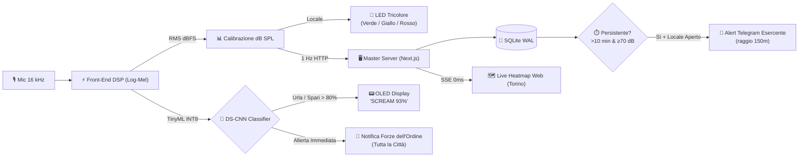

# 🏙️ NoiStop / Torino Noise Monitor

<div align="center">

[](https://nextjs.org/)
[](https://react.dev/)
[](https://www.sqlite.org/)
[](https://www.tensorflow.org/lite/microcontrollers)
[](#-hardware-prototipo-vs-produzione-reale-10-)
[](LICENSE)

**Rete urbana di sensori acustici intelligenti per la gestione preventiva della movida e la sicurezza stradale.**

[Panoramica](#-visione-del-progetto) • [Come Funziona](#-come-funziona) • [Edge AI](#-edge-ai--machine-learning) • [Hardware & BOM](#-hardware-prototipo-vs-produzione-reale-10-) • [Sicurezza](#-architettura--politiche-di-sicurezza) • [Comandi & Setup](#-avvio-rapido)

</div>

---

## 🎯 Visione del Progetto

Le aree urbane ad alta densità di vita notturna (es. San Salvario, Vanchiglia e Centro a Torino) affrontano quotidianamente due sfide parallele:

| 🔇 Gestione Rumore Urbano | 🚨 Sicurezza Stradale Notturna |
|---|---|
| **Problema:** Conflitto costante tra locali (rischio sanzioni e chiusura) e residenti (diritto al riposo). I controlli tradizionali sono lenti, punitivi ed *ex-post*. | **Problema:** Eventi critici (urla di aiuto, spari, schianti o incidenti) rischiano di non essere segnalati tempestivamente alle forze dell'ordine. |
| **Soluzione NoiStop:** Monitoraggio continuo in dB(A), segnalazione visiva (LED) in loco e **allerta preventiva via Telegram** all'esercente per consentirgli di abbassare il volume prima dell'arrivo delle multe. | **Soluzione NoiStop:** Riconoscimento istantaneo on-device dei suoni di emergenza tramite TinyML con **notifica immediata alle Forze dell'Ordine** e localizzazione precisa. |

> [!NOTE]
> **🛡️ Zero Audio Storage & Piena Conformità GDPR**  
> L'elaborazione del segnale avviene **interamente on-edge**: i campioni audio risiedono solo per poche frazioni di secondo nella RAM volatile del sensore per il calcolo dei dB e della classe, e vengono **immediatamente distrutti**. Nessuna registrazione vocale o audio viene salvata su disco né trasmessa via rete, garantendo la totale assenza di dati personali.

---

## ⚡ Come Funziona

Il sistema opera su tre percorsi paralleli ad alta efficienza:



### 1. Indicatore Visivo Immediato (Autodisciplina)
Un modulo LED posto all'esterno del locale restituisce il livello acustico in tempo reale:
* 🟢 **Verde (< 66 dB):** Livello ottimale / nominale.
* 🟡 **Giallo (66 – 80 dB):** Attenzione, rumore in aumento.
* 🔴 **Rosso (≥ 81 dB o Pericolo):** Superamento soglia o evento critico rilevato.

### 2. Allerta Preventiva ad Escalation (Regola dei 10 Minuti)
* **Condizione:** Rumore continuo $\ge 70\text{ dB}$ per almeno **10 minuti**.
* **Filtro Orari Intelligente:** Tramite OpenStreetMap / Google Places, il sistema verifica se il locale è effettivamente aperto.
* **Anti-Spam:** Cooldown minimo di 10 minuti tra avvisi consecutivi allo stesso locale.
* **Escalation:** Se l'anomalia persiste dopo l'avviso preventivo, l'infrazione viene registrata per i report formali delle autorità.

### 3. Canale di Emergenza Sicurezza (Safety Path)
Se il classificatore TinyML riconosce suoni di pericolo (`scream`, `gunshot`, `siren`, `impact_crash`) con **confidenza > 80%**:
1. Mostra l'evento sul display OLED locale per 10 secondi.
2. Invia all'istante l'allerta con coordinate ai canali della **Polizia Locale / Forze dell'Ordine** (senza vincoli di raggio).

---

## 🧠 Edge AI & Machine Learning

Il classificatore è ottimizzato per microcontrollori a bassissimo consumo e costo ridotto:

* **Architettura:** **DS-CNN** (*Depthwise Separable Convolutional Neural Network*), conforme agli standard MLPerf Tiny.
* **Quantizzazione:** **INT8** completo (footprint **< 100 KB** in memoria SRAM).
* **Elaborazione Audio:** Campionamento 16 kHz mono $\to$ Filtro Passa-Alto a 100 Hz (elimina rumble e vento) $\to$ Spettrogramma Log-Mel (40 bande $\times$ 49 frame per finestra da 1 s).

```
┌────────────────────────────┬────────────────────────────────────────────────────────┐
│ Categoria                  │ Classi Supportate                                      │
├────────────────────────────┼────────────────────────────────────────────────────────┤
│ 🚨 Sicurezza Urbana        │ scream (urla), gunshot (spari), impact_crash, siren    │
│ 🏙️ Rumore & Vita Notturna │ human_voice / shouting, music, engine / traffic, dog   │
│ 🍃 Fondo & Ambiente        │ ambient_quiet, silence                                 │
└────────────────────────────┴────────────────────────────────────────────────────────┘
```

> [!TIP]
> **Novelty Baseline Unsupervised:** Oltre alla classificazione, il nodo calcola le statistiche mobili (*RollingStats*) sull'embedding a 64 dimensioni per rilevare anomalie contestuali rispetto al normale profilo acustico della via.

---

## 🛠️ Hardware: Prototipo vs Produzione Reale (≤ 10 €)

### 🔬 Setup di Sviluppo & Prototipazione
Durante la fase di test e validazione è stato utilizzato:
* **Arduino UNO Q (4GB RAM):** Architettura eterogenea con **Qualcomm QRB2210** (Debian Linux, elaborazione Python + ONNX) e coprocessore **STM32U585** (pilotaggio LED deterministico e display OLED I2C SSD1306 via *RouterBridge RPC*).
* **Audio:** Microfoni USB / Jack con calibrazione dB SPL (+100 dB offset software).

---

### 🏭 Nodo Industriale di Produzione: NoiStop PCB (≤ 10 €)
Per la distribuzione in serie su pali della luce o facciate urbane è stato progettato un circuito dedicato in KiCad ([HW/NoiStop](file:///c:/Users/ale3d/Documents/VSCODE_DIRECTORY/UnNomeCheTiIspira/HW/NoiStop)):

<div align="center">

| Componente | Modello / Specifica | Funzione | Costo Est. (1000 pz) |
|---|---|---|:---:|
| **Microcontrollore (MCU)** | Espressif ESP32-WROOM-32E (8MB) | DSP, Inferenza INT8, Wi-Fi / Mesh | **2.30 €** |
| **Microfono Digitale** | TDK InvenSense MMICT5848-00-012 | MEMS digitale I2S per esterni | **1.70 €** |
| **Alimentatore AC-DC** | Hi-Link HLK-PM01 (220V ➔ 5V 3W) | Connessione diretta ai lampioni pubblici | **2.30 €** |
| **Circuito Stampato (PCB)** | Custom PCB 2-Layer KiCad | Scheda compatta a 2 layer con fori | **0.60 €** |
| **Assemblaggio (PCBA)** | SMT Pick & Place automatizzato | Saldatura industriale componenti | **0.65 €** |
| **Case Esterno** | Scatola plastica ABS Grado **IP65** | Impermeabilità e protezione UV | **1.85 €** |
| **COSTO TOTALE UNITARIO** | | *(Comprensivo di spedizione media)* | **~ 9.40 € (Max 10 €)** |

</div>

> [!IMPORTANT]
> Con un costo unitario inferiore a **10 €**, un'intera rete di 100 nodi a copertura di un quartiere richiede meno di **1.000 € di hardware**.

---

## 🔒 Architettura & Politiche di Sicurezza

Il backend adotta una strategia di hardening allineata agli standard OWASP:

```
┌─────────────────────────────────┬────────────────────────────────────────────────────────┐
│ Ambito                          │ Misura di Protezione                                  │
├─────────────────────────────────┼────────────────────────────────────────────────────────┤
│ 🛡️ Autenticazione Sensori       │ Validazione via header x-api-key o Bearer token        │
│ ⏱️ Rate Limiting Anti-DoS       │ Finestra scorrevole in RAM (max 25 req/5s per sensore) │
│ 🔐 Password Admin               │ Hash Scrypt con salt a 16 byte e timingSafeEqual       │
│ 🎫 Sessioni Web                 │ Token firmati crittograficamente con HMAC-SHA256       │
│ 👥 Ruoli Utente (RBAC)          │ Superadmin (controllo totale) vs Operatore (gestione)  │
│ 🔑 Chiavi Telegram Monouso      │ Formato TN-XXXX con indirizzo certificato pre-abbinato │
│ ⏱️ Anti-Replay Timestamp        │ Dati con età > 120 secondi scartati automaticamente    │
└─────────────────────────────────┴────────────────────────────────────────────────────────┘
```

---

## 🤖 Interfaccia Telegram (@NoiseTurin_bot)

Il bot gestisce le comunicazioni con gli esercenti e le forze dell'ordine:

| Comando | Descrizione |
|---|---|
| `/login <chiave>` | Attiva la **chiave monouso** (es. `TN-9A4B-7C2E-1D8F`). La sede e le coordinate vengono associate all'istante! |
| `/stazioni` | Elenca le celle acustiche attive entro il raggio della propria attività con distanza esatta in metri. |
| `/raggio <metri>` | Configura il raggio di pertinenza attorno alla propria sede (default: `150m`). |
| `/stato` | Riepiloga sede certificata, coordinate, raggio e orario ultimo avviso. |
| `/test_allerta` | Simula una notifica di prova per verificare la ricezione. |

---

## 🚀 Avvio Rapido

<details>
<summary><b>1. Configurazione Ambiente & Dipendenze (Clicca per espandere)</b></summary>

```bash
# Clona il repository
git clone https://github.com/pareror/UnNomeCheTiIspira.git
cd UnNomeCheTiIspira

# Installa le dipendenze
npm install

# Configura le variabili d'ambiente
cp .env.example .env.local
```

Configura `.env.local` con:
```env
TELEGRAM_BOT_TOKEN="il-tuo-bot-token"
SENSOR_API_KEY="arduino-torino-noise-secret-2026"
INITIAL_SUPERADMIN_PASSWORD="TuaPasswordSicura2026!"
```
</details>

<details>
<summary><b>2. Comandi Principali di Esecuzione</b></summary>

```bash
# Terminale 1: Server Master Full-Stack Next.js (Dashboard + API + SSE)
npm run dev

# Terminale 2: Daemon Bot Telegram
npm run bot

# Terminale 3: Simulatore stazioni di Torino (test senza hardware)
npm run simulate

# Terminale 4: Tunnel pubblico HTTPS per ricevere dati dall'esterno
npm run tunnel
```
</details>

<details>
<summary><b>3. Avvio Client su Arduino Uno Q (4GB)</b></summary>

```bash
# Esecuzione standard Python
python3 scripts/arduino_uno_q_telemetry.py --server http://192.168.22.103:3000/api/telemetry/reading

# Con stack completo Edge AI e coprocessore STM32
cd SoundObserver
python3 python/main.py
```
</details>

<details>
<summary><b>4. Sintesi Endpoint API</b></summary>

* `POST /api/telemetry/reading`: Ingestion telemetria acustica (`station_id`, `sound_intensity`, `timestamp`).
* `POST /api/alerts/safety`: Endpoint protetto per eventi di pericolo (`scream`, `gunshot`, `confidence > 0.80`).
* `GET /api/telemetry/stream?filter=all`: Streaming Server-Sent Events (SSE) a 0ms verso la dashboard.
* `GET /api/stations`: Snapshot stazioni e zone di Torino.
</details>

---

## 📄 Licenza

Distribuito sotto licenza **MIT**. Consulta il file `LICENSE` per maggiori informazioni.